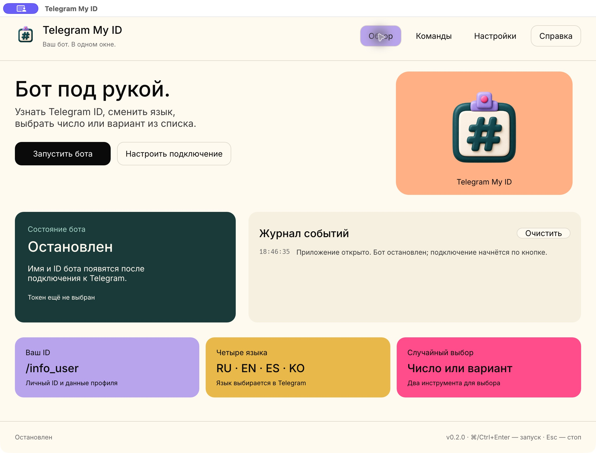
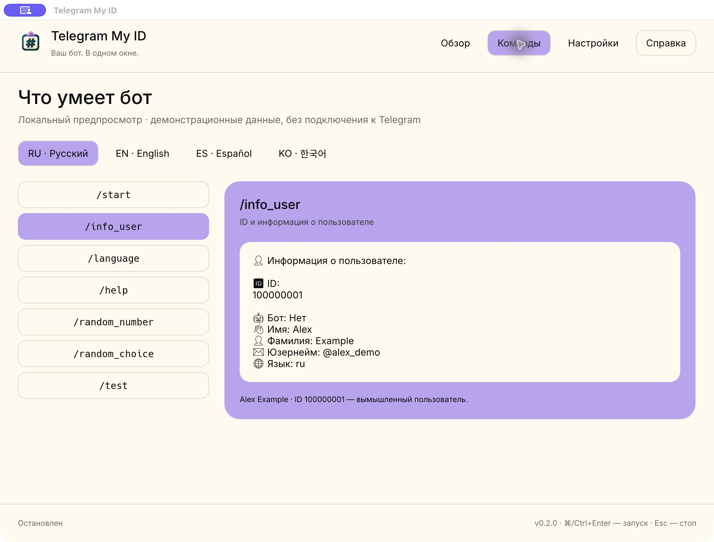
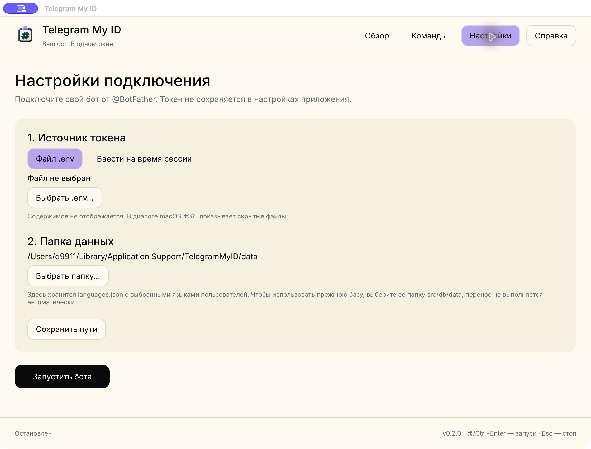

# Telegram My ID


[English](README.md) · [Русский](README.ru.md) · [Español](README.es.md)

**A small Telegram bot. A proper desktop home.**

A native macOS control room for a Telegram user-ID bot: start and stop it, inspect
connection events, configure credentials, and preview its commands without sending messages.
The desktop UI is Russian. Bot replies support Russian, English, Spanish, and Korean.

Rust 2024 · Rust 1.94+ · egui / eframe 0.35 · teloxide 0.17



This is the actual macOS application. The bot is stopped in this screenshot.
Preview screenshots use the fictional Alex Example, ID `100000001`.

<details>
<summary>Command preview</summary>



</details>

<details>
<summary>Connection settings</summary>



</details>

## Features

| Area | Behavior |
| --- | --- |
| Bot control | Manual start, cancellable connection, stop, and bounded dispatcher shutdown |
| Connection | Checks the bot with Telegram before starting long polling; shows its username and ID |
| Journal | Last 150 events in memory, credential redaction, no automatic log files |
| Credentials | Read a selected `.env`, or enter a masked token for the current app session |
| Settings | Saves only the `.env` path and data-folder path, never the bot token |
| Preview | Seven commands in four languages, using existing formatters and synthetic data |
| Storage | Existing language JSON format, atomic replacement, and a per-folder runtime lock |
| Appearance | Warm cream canvas, teal/lavender/peach/ochre/pink cards, a 3D clay badge |

Opening the app does not start the bot. Network requests begin after **Запустить бота**
(Start bot). The app uses long polling and does not automatically remove an existing webhook.
Do not run the same bot token in multiple polling clients at once.

## Quick start on macOS

1. Run `make setup`, `make doctor`, then `make local`; install the app from the DMG and open it from Applications. Building requires Python 3.11+ as well as Rust and native compiler tools.
2. Open **Настройки** (Settings). Select your `.env` containing `TELOXIDE_TOKEN`, or
   choose **Ввести на время сессии** and paste the token from @BotFather.
   In a macOS file dialog, Cmd+Shift+. reveals hidden files such as `.env`.
3. Choose the data directory. To reuse an existing language database, choose the
   old `src/db/data` directory. No files are moved automatically.
4. Click **Сохранить пути** to remember the paths, then **Запустить бота**.
5. Once Telegram has confirmed the bot, open it in Telegram and send `/start`.

Stop with **Остановить бота** or Esc. Cmd+Enter starts the bot when it is stopped.
Enable **Настройки → Закрытие окна → Продолжать работу бота после закрытия приложения** to keep the worker running after the GUI exits. Otherwise, closing the window stops it. Reopening the app reconnects to the worker.

## Bot commands

| Command | Purpose |
| --- | --- |
| `/start` | Welcome and language selection |
| `/info_user` | Your Telegram ID and profile information |
| `/language` | Choose Russian, English, Spanish, or Korean |
| `/help` | Available commands |
| `/random_number` | Generate a number in a supplied range |
| `/random_choice` | Choose an entry from a comma-separated list |
| `/test` | Show bot diagnostics and translation examples |

The bot shows the sender's own information. It is not a service for finding
private information about arbitrary Telegram accounts.

## Configuration and data

`.env.example` documents the required key. Keep your actual `.env` outside the app bundle.
An optional `TELOXIDE_PROXY` is also supported in the selected file.
It is read each time the bot starts; its contents are not copied into app preferences.
A manually entered token lives only in memory until the application closes.

On macOS, the default desktop locations are:

```text
~/Library/Application Support/TelegramMyID/settings.json
~/Library/Application Support/TelegramMyID/data/languages.json
```

The data folder can be changed in the UI. Existing JSON files use the same
`{"languages":{"100000001":"ru"}}` structure. A malformed database is reported
instead of being silently replaced. The `bot.lock` file may remain after shutdown;
the operating-system lock, rather than the file's existence, controls ownership.

## Development and packaging

Use Rust 1.94+ and Xcode Command Line Tools. Run from the repository directory:

| Command | Action |
| --- | --- |
| `make` / `make dev` | Build and open the development GUI |
| `make build` | Build GUI + CLI and the native installer |
| `make run` | Open an existing release without rebuilding |
| `make start` | Build and open the release |
| `make cli` | Run the headless Telegram bot |
| `make check` | Formatting, strict Clippy, and tests |
| `make icons` | Re-export PNG, macOS ICNS, and ICO assets |

Packaging reads only the executable, plist, public assets, README files, and licenses.
It does not package `.env`, saved settings, or user-language databases. The default
signature is local ad hoc; use `TELEGRAM_MY_ID_SIGNING_IDENTITY` for an existing signing
identity. Notarization and publication are not performed.

The current release package targets macOS on the architecture of the build machine.
Windows and Linux runtime behavior have not been verified. The ICO asset is supplied;
no Windows release package is claimed.

Headless mode preserves the `telegram-bot` binary and legacy data location:

```sh
RUST_LOG=info cargo run --locked --bin telegram-bot
```

It reads `TELOXIDE_TOKEN` from the environment or local `.env`, uses `src/db/data`
by default, and accepts an explicit `TELEGRAM_MY_ID_DATA_DIR`. Ctrl+C stops it.
To share a database with the desktop app, configure the same absolute data directory.

## Verification

```sh
cargo fmt --all -- --check
cargo clippy --locked --all-targets --all-features -- -D warnings
cargo test --locked
```

Tests cover existing command names and random functions, previews in all four languages,
credential validation/redaction, storage round trips, malformed-file preservation,
cancellation, runtime locking, and connection/polling/shutdown against a loopback-only API.
No live Telegram messages are sent by the tests. Live operation with a real token needs
checking separately by the bot owner.

## Project layout

| Path | Responsibility |
| --- | --- |
| `src/main.rs`, `src/desktop/` | Native window, design tokens, previews, worker control |
| `src/runtime.rs` | Shared Telegram dispatcher and shutdown |
| `src/settings.rs` | Credential validation, redaction, and path-only preferences |
| `src/bin/telegram-bot.rs` | Headless entry point |
| `src/application/`, `src/domain/` | Existing handlers, use cases, and domain services |
| `src/infrastructure/` | Telegram and file-storage adapters |
| `src/locales/` | RU / EN / ES / KO translations |
| `assets/`, `scripts/`, `packaging/` | Icons, fonts, screenshots, and packaging |

## Assets and license

The clay badge was generated for this project; the original source and exports are in
`assets/icons/`. Icon export uses Node.js and macOS `sips`; normal app builds and runtime
need no Node.js or NVM setup. All fonts are bundled, so previews do not fetch web fonts.

Inter, Noto Sans KR, and Noto Emoji are distributed with their SIL Open Font Licenses in
[assets/fonts](assets/fonts). Their upstream sources are the Google Fonts repositories:
[Inter](https://github.com/google/fonts/tree/main/ofl/inter),
[Noto Sans KR](https://github.com/google/fonts/tree/main/ofl/notosanskr),
[Noto Emoji](https://github.com/google/fonts/tree/main/ofl/notoemoji).

Project terms: [LICENSE](LICENSE). Author: [d9911](https://github.com/d9911).


## Native installers

Run `make setup`, `make doctor`, then `make local` to build the current sources and
open the native installer. `make run` opens the existing release. Windows also has
`./package.ps1 setup`, `./package.ps1 doctor`, and `./package.ps1 local`, without GNU Make.
Both GUI and headless binaries are packaged. Outside a checkout, the CLI defaults
to per-user data storage when no legacy `src/db/data` or explicit data directory exists.
See [docs/INSTALLERS.md](docs/INSTALLERS.md) for dependencies, outputs and verified platforms.


Background behavior, credential lifetime and local stop commands: [docs/BACKGROUND.md](docs/BACKGROUND.md).
